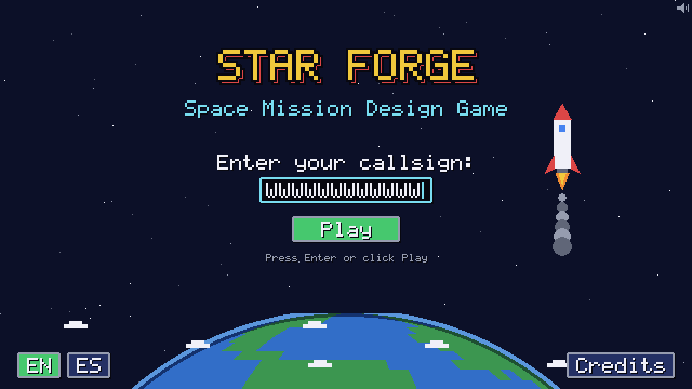
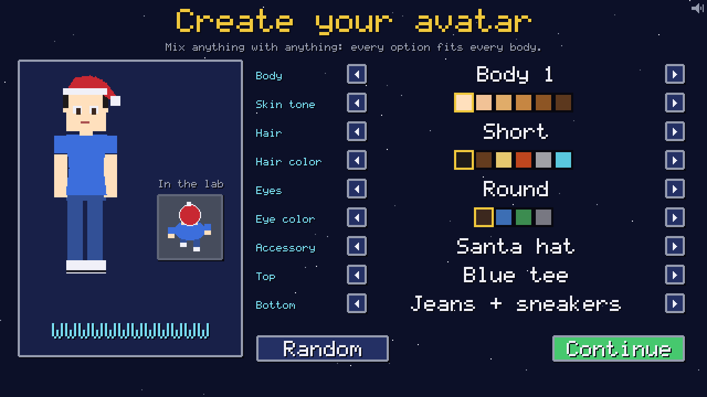
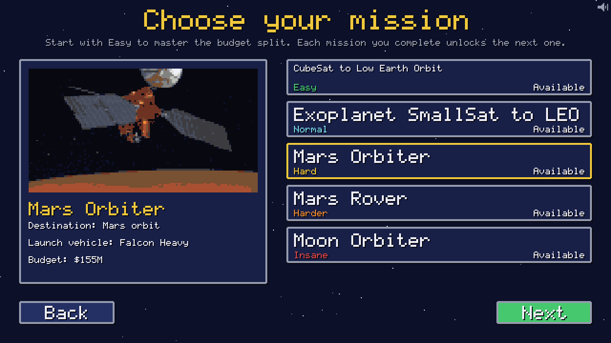
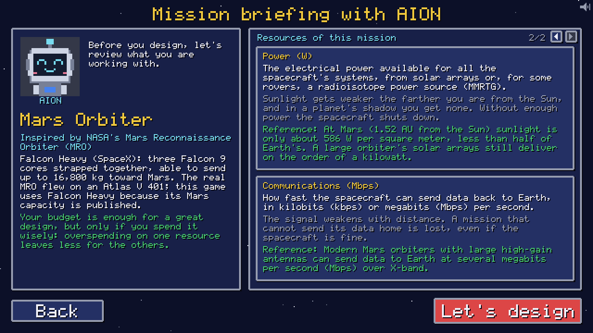
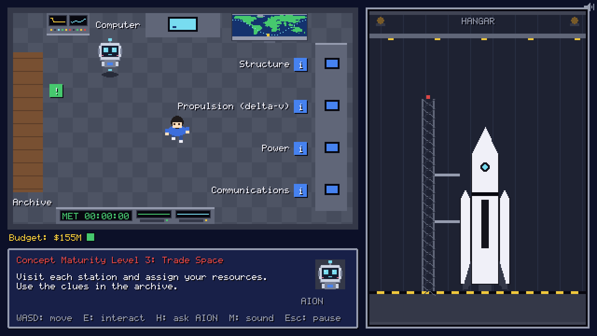
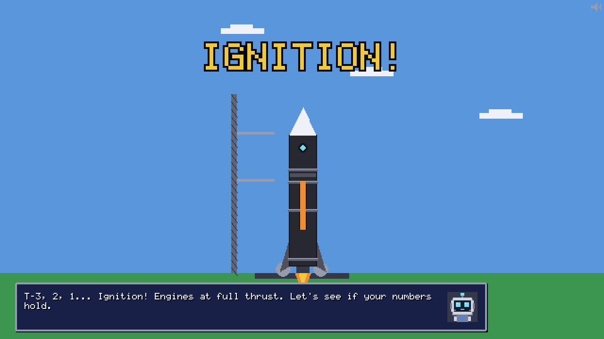
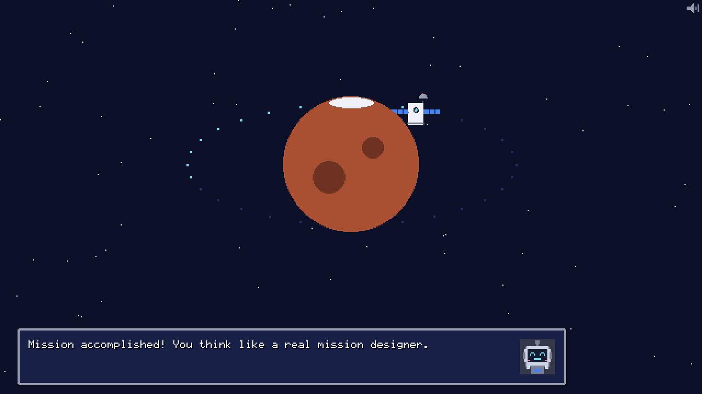
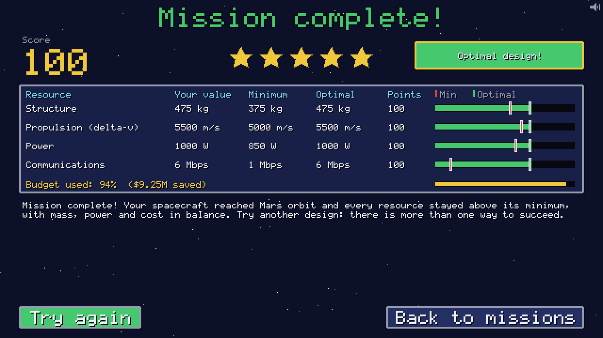
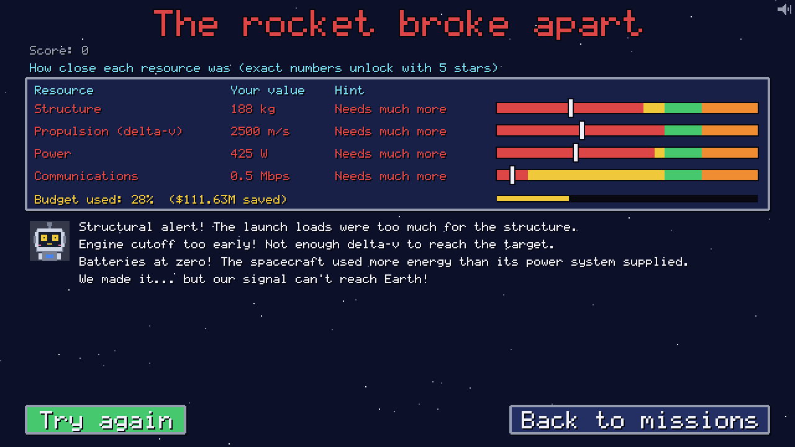

# STAR FORGE — Space Mission Design Game

**A 16-bit educational game where you design real space missions on a limited budget.**
Built by team **AION SPACE** for the **NASA Space Apps Challenge 2026** (Lima, Peru) — challenge: *Space Mission Design Game*.



## What is Star Forge?

Real mission design is a balancing act: improving one subsystem always costs something else. Star Forge lets students aged 12–17
experience that trade-off. Players pick a mission inspired by a real one (from a CubeSat in low Earth orbit to Artemis I), get its real
launch vehicle and a limited budget, and split that budget across the spacecraft's resources: **structure, propulsion (delta-v), power,
communications, science instruments and endurance**.

The twist: **the minimum and optimal value of every resource is hidden.** Players only get clues (distance to the destination, sunlight
available, launch loads) and must reason like engineers. The mission follows JPL's **Concept Maturity Levels (CML 1–4)** inside a walkable
mission control room, and then the launch is simulated. If any resource ends up below its minimum, the mission fails in a specific way
(the rocket breaks apart, never reaches its target, runs out of power or loses contact with Earth) and the game explains why.

## Screenshots

| | |
|---|---|
|  |  |
|  |  |
|  |  |
|  |  |

## How to run

Requirements: **Python 3.10 or newer** and **pygame 2.5+**. Works on macOS, Windows and Linux. No internet connection needed.

```bash
git clone https://github.com/presleygh08/NSAC-AION.git
cd NSAC-AION
python3 -m pip install -r requirements.txt
python3 app.py
```

On Windows use `python` instead of `python3`. If you have several Python versions, run the game with the one where pygame is installed
(for example `python3.12 app.py`).

## How to play

1. **Enter your callsign** and create your **avatar** (body, skin tone, hair, eyes, accessory and clothes freely combinable).
2. **Choose a mission.** Missions unlock in order: Easy → Normal → Hard → Harder → Insane.
3. **Mission briefing with AION**, your robot assistant: what each resource means, why it matters and a real-world reference.
4. **Mission control room** (walk with the arrow keys or WASD):
   - **CML 1 – Cocktail Napkin:** confirm the goal, destination and launch vehicle at the computer. The hangar doors open.
   - **CML 2 – Initial Feasibility:** read the mission clues; they stay stored in the archive.
   - **CML 3 – Trade Space:** at each station, type the amount of a resource (kg, m/s, W, Mbps, days) and see its cost.
     The total spent is never shown: keep track of your budget yourself.
   - **CML 4 – Point Design:** the budget review only tells you whether you are over budget.
5. **Launch.** The first seconds look the same for success and failure. Then the mission succeeds or fails because of its weakest resource.
6. **Results.** Each resource is shown on a bar with zones (below minimum, acceptable, optimal, more than needed). Exact numbers are
   revealed only when you earn 5 stars. **Try again** brings you back to CML 4 with your previous values.

| Key | Action |
|---|---|
| Arrows / WASD | Move |
| E | Interact |
| Enter | Confirm |
| H | Ask AION |
| M | Mute / unmute |
| Esc | Pause menu (resume, restart, back to missions, main menu, language) |

The game starts in **English**; Spanish is available from the title screen (EN | ES) and from the pause menu.

## Missions

| Difficulty | Mission | Inspired by | Launch vehicle in game | Resources to balance | Budget |
|---|---|---|---|---|---|
| Easy | CubeSat to Low Earth Orbit | NASA CubeSat Launch Initiative | Electron | Structure, propulsion | $18M |
| Normal | Exoplanet SmallSat to LEO | NASA Pandora (2026) | Falcon 9 | + power | $71M |
| Hard | Mars Orbiter | NASA Mars Reconnaissance Orbiter | Falcon Heavy* | + communications | $155M |
| Harder | Mars Rover | NASA Perseverance | Falcon Heavy* | + science instruments | $240M |
| Insane | Moon Orbiter | NASA Artemis I | SLS Block 1 | + endurance | $305M |

\*The real MRO flew on an Atlas V 401 and Perseverance on an Atlas V 541. The game uses Falcon Heavy because its Mars capacity is published;
the mission briefing says so.

## The science inside

- **Propulsion** uses the Tsiolkovsky rocket equation with real specific impulse and dry mass (`fisica.py`).
- **Solar power** scales with the distance to the Sun (1361 W/m² at Earth, 586 W/m² at Mars) (`potencia_costo.py`).
  The Mars rover uses a nuclear power source (MMRTG) instead, like Perseverance.
- **Minimums** come from physics or real mission requirements; **optimums** are real mission values with design margin.
- **Every mission is validated:** the minimums fit in the budget, a 5-star design exists, and most "by eye" designs fail.
  See [docs/validation.md](docs/validation.md).
- **Score:** closeness to the optimal design plus a bonus for money saved, shown as 0–5 stars.

## NASA data and resources used

- [Concept Maturity Levels (JPL)](https://dataverse.jpl.nasa.gov/dataset.xhtml?persistentId=hdl:2014/44299) — structure of every mission (CML 1–4).
- [NASA Mars Fact Sheet (NSSDC)](https://nssdc.gsfc.nasa.gov/planetary/factsheet/marsfact.html) — solar irradiance and distance of Mars.
- [Mars Reconnaissance Orbiter (NASA/JPL)](https://science.nasa.gov/missions/mars-reconnaissance-orbiter/) — dry mass, power and data rate.
- [Mars 2020 Perseverance (NASA/JPL)](https://www.jpl.nasa.gov/news/press_kits/mars_2020/launch/quick_facts/) — rover mass, instruments and power source.
- [Artemis I (NASA)](https://www.nasa.gov/humans-in-space/artemis/) — mission duration and profile.
- [Space Launch System (NASA)](https://www.nasa.gov/humans-in-space/space-launch-system/the-great-escape-sls-provides-power-for-missions-to-the-moon-duzxi/) — SLS Block 1 capability.
- [State-of-the-Art of Small Spacecraft Technology (NASA, 2024)](https://www.nasa.gov/wp-content/uploads/2025/02/soa-2024.pdf) and
  [What are SmallSats and CubeSats (NASA)](https://www.nasa.gov/smallsat-institute/what-are-smallsats-and-cubesats/) — CubeSat and small-satellite values.
- [NASA Image and Video Library](https://images.nasa.gov) — mission preview photos (pixelated in game; list in [assets/CREDITOS.md](assets/CREDITOS.md)).

Every value in the game, its source and whether it is verified or a team estimate: **[docs/data-sources.md](docs/data-sources.md)**.

## Other data and tools

ESA (design margins, Orion European Service Module), DLR (Artemis I MARE experiment), Rocket Lab (Electron), SpaceX (Falcon 9, Falcon Heavy),
Cal Poly (CubeSat standard), [Python](https://www.python.org) and [pygame](https://www.pygame.org) (LGPL). All pixel art, the pixel font and
all sounds are made in code by the team. Full list in [docs/data-sources.md](docs/data-sources.md) and [assets/CREDITOS.md](assets/CREDITOS.md).

## Use of AI

AI tools (**Claude** and **Claude Code**, by Anthropic) were used to assist with code generation, debugging, translation and documentation.
The game concept, game design decisions, data selection and validation were made by the team. No AI-generated images, video or audio
are used in the game; all graphics and sounds are generated by our own code.

## Project structure

```
app.py                  entry point (main loop)
nucleo.py               game core: missions, budget split, simulation, score (no graphics)
fisica.py               rocket equation
potencia_costo.py       solar power and cost functions
jugar_consola.py        play the game core from the terminal (no graphics)
revisar_textos.py       test mode: checks that no text overflows its box (EN and ES)
datos/                  mission parameters, launch vehicles, destinations, messages (EN/ES)
interfaz/               Pygame screens, sprites, sound, texts (EN/ES)
assets/                 mission preview photos and credits
docs/                   screenshots, data sources, validation; team-notes/ has internal planning notes (Spanish)
archive/                earlier versions kept for reference (not used by the game)
```

## Team AION SPACE

- Emanuel Presley Gonzales Herrera — game core, physics and integration
- William Gonzalo Bejarano Gutierrez — user interface (Pygame)
- Bryan Will Chambi Alcaraz — research and mission data
- Justin Boris Aguilar Mondragon — game definition, content and pitch
- Gian Piero Arista Vigo — visual design, README and submission

## License

[MIT](LICENSE) for the code. NASA images are used under the [NASA media usage guidelines](https://www.nasa.gov/nasa-brand-center/images-and-media/)
and do not imply NASA endorsement. Star Forge is not affiliated with or endorsed by NASA.
