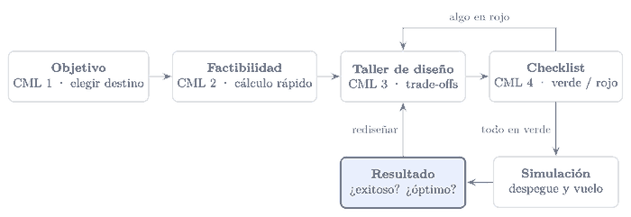

> Concepto del juego (Google Doc "Bosquejo v3"), exportado el 14 nov 2026. Para roles, contrato, recursos y reparto manda `reparto-v4.md`.

**Space Mission Design Game**

Bosquejo de trabajo · versión 3

NASA Space Apps Challenge 2026 · Sede Lima

14 de noviembre de 2026

*Documento base para completar por el equipo. Las ideas son propuestas en evaluación: aún no sabemos si todas son realizables en 48 horas. Lo marcado como [Por completar] queda pendiente para el equipo.*

## **1   La aplicación en resumen**

Space Mission Design Game es un juego educativo para estudiantes de 12 a 17 años en el que el jugador diseña misiones espaciales reales optimizando los recursos de un cohete, con datos de la NASA. Así funciona, paso a paso:

> 1. **Inicio y avatar:** el jugador abre el juego y elige su avatar.  
> 2. **Parrilla de misiones:** ve misiones basadas en misiones reales, cada una con una etiqueta de dificultad (Easy, Normal, Hard, Harder, Insane). Más dificultad significa más recursos que optimizar.  
> 3. **Objetivo (CML 1):** al elegir una misión, el juego presenta su meta, su destino y el cohete base de esa misión, con su capacidad de carga y su costo reales.  
> 4. **Presupuesto y pistas (CML 2):** el jugador recibe un presupuesto y pistas cualitativas sobre la misión (por ejemplo, la distancia al destino o cuánta luz solar llega allí), pero no ve el valor mínimo que necesita cada recurso.  
> 5. **Taller de diseño (CML 3):** el jugador reparte el presupuesto entre los recursos del cohete base y decide, según su criterio, a qué recurso darle más dinero. No hay una única respuesta correcta.  
> 6. **Revisión antes del lanzamiento (CML 4):** solo se verifica que el reparto no supere el presupuesto; los valores mínimos y óptimos siguen ocultos.  
> 7. **Simulación:** animación del lanzamiento. Si algún recurso quedó bajo su mínimo, se ve la falla correspondiente: el cohete explota, no llega al destino, se apaga o queda incomunicado. Si todos lo superan, la misión se completa.  
> 8. **Resultado:** si la misión se completa, el puntaje depende de qué tan cerca quedó cada recurso de su valor óptimo (pasarse también resta). Después, el juego revela el mínimo y el óptimo de cada recurso y explica por qué, para que el jugador aprenda y reintente.  
> 9. **Progresión:** el jugador avanza a misiones más difíciles, donde aparecen nuevos recursos y conceptos.

## **2   Equipo y roles**

| Integrante | Área | Entrega para el juego |
| :---- | :---- | :---- |
| Emanuel Gonzales | Física, lógica e integración | delta_v, masa_propelente, estado, misiones, puntaje y evaluar_mision |
| Gonzalo Bejarano | Interfaz en Pygame | Avatar, parrilla de misiones, taller de reparto, revisión, simulación y resultados |
| Bryan Chambi | Potencia, masa, costo | potencia_generada, balance_potencia, costo_total y reglas de falla |
| Justin Aguilar | Diseño del juego y pitch | Misiones por dificultad, mensajes.json, demo y video |
| Gian Piero Arista | Datos NASA y documentación | lanzadores.json, destinos.json, misiones.json, README y entrega |

Tabla 1: Roles del equipo.

## 

| Integrante | Área | Entrega para el juego |
| :---: | :---: | :---: |
| Gonzalo | Interfaz Pygame (solo pantallas) | Avatar, parrilla de misiones, taller de reparto del presupuesto, revisión antes del lanzamiento y resultados (con el revelado de mínimos y óptimos). Con la UI en pie, la simulación animada con sus finales: completada, explota, no llega, se apaga o incomunicada.  |
| Emanuel | Núcleo y puente con la UI | Limpiar juego.py (hay código duplicado en nueva_mision). Crear app.py con la acción simular. Unificar las claves del estado (m_seca_kg en juego, masa_seca_kg en pantallas). Hacer que evaluar_mision devuelva datos_mensaje. Definir el puntaje con el margen “óptimo”. Cargar misiones.json.  |
| Chambi | Recursos nuevos y modo equipo | Modelos simples de comunicaciones, datos y tiempo, como funciones con asserts. Reglas de falla nuevas. Modo por turnos para hasta 4 jugadores (roles y turno), más una lógica sencilla que luego Gonzalo conecta a la UI.  |
| Piero | Datos NASA y repositorio | misiones.json con cohetes verificados (MRO y Perseverance no usaron el Atlas V 551). instrumentos.json con valores de CubeSat 101\. Datos para la pantalla de créditos. README en inglés (instalación, capturas, créditos, nota de IA), requirements.txt, licencia. Probar la versión web con pygbag.  |
| Justin | Contenido, pruebas y demo | mensajes.json en inglés, con plantillas {destino} y explicaciones del porqué. Ayudas (tooltips) por decisión. Ampliar textos_en.json. Fijar los números de Easy y Normal y jugarlas para comprobar que tienen solución. Avatares y sprites originales. Guión y demo (video ≤30 s o ≤7 diapositivas) y campos de la página de proyecto.  |

## **3   El problema y el reto**

El reto pide un juego donde el jugador diseña, gestiona y simula una misión espacial completa, equilibrando recursos que compiten entre sí: mejorar un aspecto suele empeorar otro. Una solución sólida incluye una interfaz clara, gestión visible de recursos (masa, potencia, presupuesto, datos, comunicaciones y tiempo), colaboración para hasta 4 jugadores, y una simulación que explique por qué la misión triunfa o falla. Nos evalúan en Impact, Creativity, Validity, Relevance (datos NASA como núcleo) y Presentation. Entrega: domingo 15 antes de las 11:59 p. m., todo en inglés, con demo de máximo 30 s o 7 diapositivas.

## **4   Público objetivo**

El juego está pensado para estudiantes de **12 a 17 años**. Elegimos este rango porque a esa edad ya manejan, o están aprendiendo en el colegio, las ideas que el juego usa: masa, energía y potencia, presupuesto y proporciones. El reto también clasifica este desafío como apto para un nivel principiante-juvenil.

> * Lenguaje simple y ayudas breves en pantalla, sin fórmulas a la vista.  
> * Retroalimentación visual clara: una barra de presupuesto restante mientras reparte y, después de la simulación, la comparación de lo elegido con el mínimo y el óptimo de cada recurso. Durante el reparto no se muestran los mínimos.  
> * Aprendizaje progresivo: cada dificultad agrega pocos recursos nuevos.  
> * Etiquetas de dificultad familiares para jugadores jóvenes, con íconos y estilo visual propios.  
> * Regla del reto: la demo y el proyecto no pueden incluir imágenes, video ni voz de menores de 18 años.

[Por completar: contexto de uso (colegio, casa, talleres) y conocimientos previos que suponemos.]

## **5   Pantalla de inicio: avatar y parrilla de misiones**

Tras elegir un avatar original del juego (sin imágenes de personas reales), el jugador ve una parrilla de misiones basadas en misiones reales, cada una con su cohete base y una etiqueta de dificultad; la dificultad indica cuántos recursos hay que optimizar.

| Dificultad | Misión base (propuesta) | Destino | Cohete base | Recursos a optimizar |
| :---- | :---- | :---- | :---- | :---- |
| Easy | Satélite pequeño tipo CubeSat [por confirmar] | LEO | Electron | Masa, presupuesto, estructura |
| Normal | [Por completar: misión real a órbita terrestre] | LEO | Falcon 9 | \+ potencia |
| Hard | Mars Reconnaissance Orbiter | Órbita de Marte | [Verificar cohete] | \+ delta-v (propelente) |
| Harder | Perseverance | Superficie de Marte | [Verificar cohete] | \+ comunicaciones |
| Insane | Artemis I | Órbita lunar | SLS Block 1 | \+ datos (ciencia) y tiempo: los 8 recursos |

Tabla 2: Parrilla de misiones por dificultad (propuesta; misiones y cohetes por verificar con fuentes).

**Notas para verificar.** Mars Reconnaissance Orbiter y Perseverance usaron versiones del Atlas V distintas de la 551 que tenemos en lanzadores.json, y para la 551 no hay capacidad a Marte publicada. Falcon Heavy podría ser una alternativa para una misión interplanetaria. Para las 48 horas, lo realista es construir Easy y Normal completas y mostrar el resto como "próximamente". [Por completar: ¿las misiones se desbloquean en orden o están abiertas desde el inicio?]

## **6   Flujo de cada misión**

Cada misión sigue los niveles de madurez de concepto (CML) de JPL: objetivo, reparto del presupuesto, revisión y simulación. Cada recurso tiene dos valores ocultos, definidos por el equipo a partir de la misión real: un mínimo, por debajo del cual la misión falla, y un óptimo, que da el puntaje máximo. El jugador no los conoce: debe razonar con las pistas a qué recurso darle más dinero.

Figura 1: Flujo de cada misión, basado en los niveles CML de JPL.

**Fallas y puntaje.** Si un recurso queda bajo su mínimo, la simulación muestra su falla: estructura, el cohete explota; propulsión (delta-v), no llega al destino; potencia, la nave se apaga; comunicaciones, queda incomunicada. Si todos superan el mínimo, la misión se completa y cada recurso suma puntos según su cercanía al óptimo. Regla de ejemplo: puntos \= 100 × (1 − \|valor − óptimo\| / óptimo), con 0 como mínimo; el puntaje final es el promedio. [Por completar: cuánto compra cada unidad de presupuesto en cada recurso, y los mínimos y óptimos de cada misión.]

## **7   Recursos a optimizar**

| Recurso | Qué mide | Unidad | Restricción en el juego | Desde |
| :---- | :---- | :---- | :---- | :---- |
| Masa | Nave \+ carga útil \+ propelente | kg | No superar la capacidad del cohete al destino | Easy |
| Presupuesto | Costo de cohete, nave e instrumentos | M USD | No superar el presupuesto de la misión | Easy |
| Estructura | Resistencia del cohete y la nave al despegue | [Por definir] | Bajo el mínimo, el cohete explota | Easy |
| Potencia | Energía de los paneles frente al consumo | W | Generación mayor que el consumo; baja con la distancia al Sol | Normal |
| Delta-v (propelente) | Cambio de velocidad que puede lograr la nave | m/s | Alcanzar el delta-v del destino | Hard |
| Comunicaciones | Capacidad de enviar datos a la Tierra | [Por definir] | Antena mayor \= más masa y potencia; baja con la distancia | Harder |
| Datos (ciencia) | Valor científico de los instrumentos | [Por definir] | Cumplir el objetivo científico mínimo | Insane |
| Tiempo | Duración del viaje y de la operación | días | [Por definir] | Insane |

Tabla 3: Recursos a optimizar y dificultad en que aparecen (propuesta).

**Condición para que exista un óptimo.** El presupuesto es limitado: el dinero que se pone en un recurso no se puede poner en otro, y pasarse del óptimo resta puntos. Así existe un reparto ideal, aunque varios repartos pueden completar la misión. [Por completar por Chambi y Emanuel: valores con fuente.]

## **8   Datos y recursos NASA**

| Recurso | Qué aporta al juego | Archivo |
| :---- | :---- | :---- |
| [Concept Maturity Levels](https://dataverse.jpl.nasa.gov/dataset.xhtml?persistentId=hdl:2014/44299) (JPL) | Estructura de cada misión: objetivo, factibilidad, alternativas y diseño final con márgenes | Concepto del juego |
| Datos de lanzadores (SpaceX, ULA, Rocket Lab, guía de SLS de NASA) | Capacidad y costo de los cohetes base | lanzadores.json |
| NASA Glenn, Basics of Space Flight, mapa de delta-v | Delta-v y distancia al Sol de cada destino | destinos.json |
| Misiones reales de NASA | Base de la parrilla: Artemis I, MRO y Perseverance | misiones.json |
| [CubeSat 101](https://www3.nasa.gov/sites/default/files/atoms/files/nasa_csli_cubesat_101_508.pdf) (NASA) [por evaluar] | Masas, potencias y costos realistas para la misión Easy e instrumentos | [Por crear] |

Tabla 4: Datos y recursos NASA.

*Δv* \= *I*sp *g*0 ln(*m*0/*m*f)      *m*p \= *m*s(e*Δv*/(*I*sp *g*0\) − 1\)      *P* \= (*S*0/*d*²) *A η*

## **9   Estado actual del prototipo**

En el repositorio [presleygh08/NSAC-AION](https://github.com/presleygh08/NSAC-AION) ya están los datos con fuentes (Piero), los mensajes de resultado en inglés (Justin), las funciones de física, potencia y costo con pruebas (Emanuel y Chambi) y un esqueleto navegable de la interfaz en Pygame (Gonzalo). Faltan evaluar_mision y la lógica de misiones (Emanuel), las pantallas de avatar, parrilla, reparto del presupuesto, revisión, simulación y resultados (Gonzalo), y el README en inglés con licencia y nota de uso de IA (Piero).

## **10   Preguntas abiertas**

> 1. ¿Cuántas misiones de la parrilla construimos completas en 48 horas?  
> 2. ¿Las misiones se desbloquean en orden o están todas abiertas?  
> 3. ¿La interfaz del juego va en inglés o bilingüe?  
> 4. ¿Incluimos el modo para hasta 4 jugadores o lo dejamos como propuesta?  
> 5. [Por completar por el equipo.]
