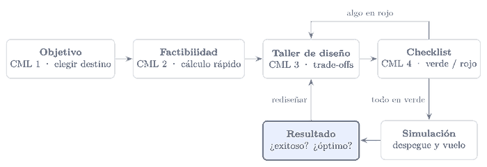

# Reparto y definición — Bosquejo v4 (14 nov 2026)

> Fuente de verdad del equipo para el flujo, roles y contrato. Texto extraído del PDF "Bosquejo v4" (las tablas conservan el formato de columnas). Complementa a `concepto-juego.md` (v3); si chocan, manda esta v4. El diagrama del flujo está en `flujo_juego.png`.



```text
Space Mission Design Game
                             Bosquejo de trabajo · versión 4
                         NASA Space Apps Challenge 2026 · Sede Lima
                                  14 de noviembre de 2026

Cambios respecto a v3: roles reordenados (Gonzalo es dueño de app.py; Piero apoya el diseño visual;
Justin cierra la definición del juego), tabla de recursos corregida para el flujo de reparto de presu-
puesto, contrato de datos único (parametros_misiones.json) y ficha de investigación detallada
para Chambi. Lo marcado como [Por completar] o [Decidir] queda pendiente.

1 La aplicación en resumen

Space Mission Design Game es un juego educativo para estudiantes de 12 a 17 años en el que
el jugador diseña misiones espaciales reales repartiendo un presupuesto limitado entre los
recursos de un cohete, con datos de la NASA. Así funciona:

1. Inicio y avatar: el jugador abre el juego y elige su avatar.
2. Parrilla de misiones: ve misiones basadas en misiones reales, cada una con una etiqueta de
   dificultad (Easy, Normal, Hard, Harder, Insane). Más dificultad significa más recursos entre los
   que repartir.
3. Objetivo (CML 1): al elegir una misión, el juego presenta su meta, su destino y el cohete base,
   con su capacidad de carga y su costo reales.
4. Presupuesto y pistas (CML 2): el jugador recibe un presupuesto y pistas cualitativas (por
   ejemplo, la distancia al destino o cuánta luz solar llega allí), pero no ve el mínimo que necesita
   cada recurso.
5. Taller de reparto (CML 3): reparte el presupuesto entre los recursos. No hay una única
   respuesta correcta.
6. Revisión (CML 4): solo se verifica que el reparto no supere el presupuesto. Los mínimos y
   óptimos siguen ocultos. Si se pasó, vuelve al taller.
7. Simulación: animación del lanzamiento. Si algún recurso quedó bajo su mínimo se ve la falla
   correspondiente (el cohete explota, no llega, se apaga o queda incomunicado). Si todos lo superan,
   la misión se completa.
8. Resultado: si se completó, el puntaje depende de qué tan cerca quedó cada recurso de su
   óptimo (pasarse también resta). Después se revelan el mínimo y el óptimo de cada recurso con
   su explicación. Si falló, se explica qué recurso falló y por qué, y puede reintentar.
9. Progresión: el jugador avanza a misiones más difíciles, con nuevos recursos y conceptos.

Flujo de cada misión (texto de apoyo a la Figura ??):
Objetivo (CML1) -> Presupuesto y pistas (CML2) -> Taller de reparto (CML3) -> Revision (CML4)
  Revision   -> [se paso del presupuesto] -> Taller
  Revision   -> Simulacion
  Simulacion -> [todos >= minimo] -> Resultado (puntaje + revelado de minimos y optimos) -> Taller
     (reintentar)
  Simulacion -> [un recurso < minimo] -> Mision fallida (explota / no llega / se apaga /
    incomunicada) -> Taller (reintentar)

                                    Figura 1: Enter Caption

2 Equipo y roles (reordenado)

Principio: cada persona es dueña de un archivo o carpeta y se habla con las demás a través de
un contrato (sección 2.2). Así nadie espera a nadie.

                                  Cuadro 1: Roles del equipo.

Integrante   Área               Es dueño de            Entregables

Gonzalo      Interfaz Pyga-     app.py,                app.py (bucle y acciones). Pantallas: ava-
             me                 pantallas.py,          tar, parrilla, objetivo, presupuesto y pistas,
                                componentes.py,        taller de reparto, revisión, simulación (con
                                config.py              sus 4 fallas y el final exitoso) y resultados
                                                       con revelado. Solo llama a las funciones de
                                                       Emanuel.
Piero        Diseño       vi-   assets/, guía de es-   Guía de estilo (paleta, tipografía, íconos
             sual     (apoya    tilo, README           de dificultad). Avatares y cohete originales
             a Gonzalo) y                              (sin personas reales ni menores). Fotogra-
             repositorio                               mas o formas simples para despegue, ex-
                                                       plosión, apagado, pérdida de señal y lle-
                                                       gada. Fondos por destino. Pantalla de cré-
                                                       ditos con las fuentes NASA. README en
                                                       inglés (instalación, capturas, créditos, nota
                                                       de IA), requirements.txt, licencia, prue-
                                                       ba de pygbag.
Emanuel      Arquitectura       juego.py,              Reescribir juego.py al flujo de reparto
             interna     del    fisica.py,             (sección 2.2). Estado único con claves es-
             juego              potencia_costo.py      tables. Cálculo de mínimos con las funcio-
                                                       nes físicas. Evaluación, puntaje, revelado
                                                       y explicación. Carga de misiones.json y
                                                       parametros_misiones.json. Pruebas con
                                                       assert. Script que valida que cada misión
                                                       tiene solución (sección 7.2).
Chambi       Investigación y                       Para cada recurso de Easy y Normal: míni-
                                parametros_misiones.json
             calibración de                        mo, óptimo y cuánto compra cada M USD,
             recursos                              con fuente (ficha en la sección 10). Después,
                                                   Hard.

Integrante    Área                Es dueño de             Entregables

Justin        Definición del      mensajes.json,          Cierra las decisiones de la sección 9 (antes
              juego, conteni-     textos_en.json,         del bloque de construcción). Escribe pis-
              do y pitch          documento       de      tas, mensajes de falla y explicaciones del
                                  definición              revelado en inglés (plantillas {recurso},
                                                          {minimo}, {optimo}). Tooltips. Juega Easy
                                                          y Normal y avisa si no tienen solución. Lue-
                                                          go guion, demo (video ≤30 s o ≤7 diaposi-
                                                          tivas) y campos de la página de proyecto.

2.1 Orden de trabajo (hoy y mañana)

  Bloque                        Qué debe quedar listo

  02:00 · Misión 2: plani-      Justin presenta la definición cerrada (sección 9). Emanuel y Gon-
  ficar prototipo               zalo firman el contrato (sección 2.2). Chambi empieza con Easy.
                                Piero entrega la guía de estilo.
  03:15 · Misión 3: prime-      Easy de punta a punta: parrilla, objetivo, pistas, reparto, revisión,
  ra versión                    simulación y resultado o falla, con parámetros provisionales de
                                Chambi si hace falta.
  04:15 · Demo y página         Justin empieza guion y campos de la página. Piero empieza el
  de proyecto                   README. Todo el equipo graba material de gameplay (sin me-
                                nores de 18 años).
  04:45 · Indicaciones          Ajustar a lo que indiquen. Revisar con la lista de entrega (sec-
                                ción 11).
  Mañana (dom 15)               Temprano: Normal completa y pulido visual. Mediodía: congelar
                                el código. Tarde: demo, README y página de proyecto. Enviar
                                con margen antes de las 11:59 p. m.

2.2 Contrato Emanuel ↔ Gonzalo (propuesta)

Gonzalo solo llama a estas funciones; Emanuel solo cambia lo de dentro. Los nombres exactos los
fija Emanuel hoy en la Misión 2.

  cargar_misiones(): lista para la parrilla (id, nombre, dificultad, destino, cohete, estado de blo-
  queo).

  iniciar_mision(id): estado nuevo con presupuesto, pistas y recursos (sin mínimos ni óptimos
  visibles).

  repartir(estado, recurso, dinero): actualiza el estado; presupuesto_restante(estado)
  para la barra.

  revisar(estado): devuelve {ok, exceso} (solo presupuesto).

  simular(estado): devuelve exito o la lista de recursos bajo su mínimo, y la falla principal
  (explota, no llega, se apaga, incomunicada).

  puntaje(estado) y revelar(estado): por recurso, lo elegido, mínimo, óptimo y texto de expli-
  cación.

Claves del estado en un solo idioma (hoy m_seca_kg en juego.py y masa_seca_kg en pantallas.py
están duplicadas).

3 El problema y el reto

El reto pide un juego donde el jugador diseña, gestiona y simula una misión espacial completa,
equilibrando recursos que compiten entre sí: mejorar un aspecto suele empeorar otro. Una solución
sólida incluye una interfaz clara, gestión visible de recursos (masa, potencia, presupuesto, datos,
comunicaciones y tiempo), colaboración para hasta 4 jugadores y una simulación que explique por
qué la misión triunfa o falla. Nos evalúan en Impact, Creativity, Validity, Relevance (datos NASA
como núcleo) y Presentation. Entrega: domingo 15 antes de las 11:59 p. m., todo en inglés, con
demo de máximo 30 s o 7 diapositivas.
Cómo responde nuestro flujo: el presupuesto compite entre recursos (el trade-off ), los mínimos
salen de la física y de datos reales (Validity y Relevance) y el revelado final explica el porqué (valor
educativo).

4 Público objetivo

Estudiantes de 12 a 17 años: ya manejan, o están aprendiendo en el colegio, masa, energía,
presupuesto y proporciones. El reto clasifica este desafío como principiante-juvenil.

  Lenguaje simple y ayudas breves en pantalla, sin fórmulas a la vista.

  Durante el reparto: una barra de presupuesto restante y el valor elegido por recurso. Los mínimos
  no se muestran.

  Después de la simulación: comparación de lo elegido con el mínimo y el óptimo de cada recurso.

  Aprendizaje progresivo: cada dificultad agrega pocos recursos nuevos.

  Regla del reto: la demo y el proyecto no pueden incluir imágenes, video ni voz de menores de 18
  años.

[Por completar por Justin: contexto de uso (colegio, casa, talleres) y conocimientos
previos que suponemos.]

5 Parrilla de misiones

Tras elegir un avatar original, el jugador ve la parrilla. La dificultad indica cuántos recursos hay
entre los que repartir.

                     Cuadro 3: Parrilla de misiones por dificultad (propuesta; mi-
                     siones y cohetes por verificar con fuentes).

Dificultad Misión base                    Destino            Cohete base       Recursos del reparto

Easy         Satélite pequeño tipo        LEO                Electron          Estructura, propulsión
             CubeSat [por confir-
             mar]

                    Cuadro 3: Parrilla de misiones por dificultad (propuesta; mi-
                    siones y cohetes por verificar con fuentes).

Dificultad Misión base                   Destino             Cohete base     Recursos del reparto

Normal       [Por completar: mi-         LEO                 Falcon 9        + potencia
             sión real a órbita te-
             rrestre]
Hard         Mars Reconnaissance Or-     Órbita de Mar-      [Verificar      + comunicaciones
             biter                       te                  cohete]
Harder       Perseverance                Superficie     de   [Verificar      + datos (ciencia)
                                         Marte               cohete]
Insane       Artemis I                   Órbita lunar        SLS Block 1     + tiempo: todos los re-
                                                                             cursos

Notas para verificar (Piero). MRO y Perseverance usaron versiones del Atlas V distintas de
la 551 de lanzadores.json, y para la 551 no hay capacidad a Marte publicada. Falcon Heavy
podría ser alternativa. Para las 48 horas, lo realista es Easy y Normal completas y el resto como
“próximamente”. [Decidir (Justin): ¿se desbloquean en orden o abiertas desde el inicio?
Recomendación: en orden, porque cada nivel enseña un recurso nuevo.]
Nota: en v3 la tabla agregaba “masa, presupuesto” a Easy y “delta-v” a Hard. Con el reparto de
presupuesto, el presupuesto es el pozo que se reparte (no un recurso) y delta-v es propulsión, que
se necesita desde Easy para llegar a cualquier destino. Ver decisión sobre masa en la sección 9.

6 Reglas del juego

Cada recurso tiene dos valores ocultos, definidos por el equipo a partir de la misión real:

  Mínimo: por debajo, la misión falla. Sale de la física o de un requisito real (delta-v del destino,
  consumo de la nave, carga al despegue, tasa de datos necesaria).
  Óptimo: da el puntaje máximo. Es el valor de la misión real o de referencia, con un margen de
  diseño razonable.

El jugador no los conoce: razona con las pistas a qué recurso darle más dinero.
Condición de validez de cada misión (obligatoria). Con presupuesto P y costos de compra
por recurso:          ∑︂                      ∑︂
                         costo(mínimos) ≤ P <     costo(óptimos)
Así existe más de un reparto que completa la misión, pero ninguno alcanza el óptimo en todo: ese
es el trade-off. Si P ≥
                        ∑︁                                                  ∑︁
                           costo(óptimos) no hay decisión que tomar; si P <    costo(mínimos) la
misión es imposible.
Fallas. Estructura bajo el mínimo: el cohete explota. Propulsión (delta-v): no llega al destino. Po-
tencia: la nave se apaga. Comunicaciones: queda incomunicada. Si varios recursos fallan, se muestra
la falla del primero en el orden del despegue al destino (estructura, propulsión, potencia, comuni-
caciones) y la pantalla de resultados lista todos los recursos bajo su mínimo.
Puntaje (propuesta). Por recurso:
                                       |valor − óptimo|
                                 (︃                     )︃
                   puntos = 100 1 −                     ,    con 0 como mínimo;
                                            óptimo

el puntaje final es el promedio. [Decidir (Justin): ¿se pondera por importancia del recurso?
¿el dinero sin gastar penaliza? Recomendación: sin ponderar y sin penalizar el dinero
sin gastar, para mantenerlo simple.]
Exitoso vs. óptimo. Exitoso = todos los recursos ≥ mínimo. Óptimo = además, todos dentro de
un margen del óptimo. [Decidir (Justin): margen que cuenta como óptimo, por ejemplo
±10 %.]
Eventos aleatorios. El flujo no los incluye. La función evento_aleatorio de juego.py queda
fuera del juego base (podría volver como extra en Insane).

7 Recursos del reparto

                  Cuadro 4: Recursos del reparto y dificultad en que aparecen
                  (propuesta).

Recurso        Qué mide            Unidad     Si queda ba-       Cómo sale el míni-        Desde
                                              jo el mínimo       mo

Estructura     Resistencia del     [Por       El cohete ex-      Carga de despegue y       Easy
               cohete y la nave    definir    plota              fracción de masa es-
               al despegue         (Cham-                        tructural
                                   bi)]
Propulsión     Cambio de velo-     m/s        No llega      al   delta_v_nave     de       Easy
(delta-v)      cidad que logra                destino            destinos.json (total
               la nave                                           menos LEO)
Potencia       Energía de los      W          La nave      se    Consumo total; baja       Normal
               paneles frente al              apaga              con la distancia al Sol
               consumo                                           (potencia_generada)
ComunicacionesCapacidad     de     [Por       Queda inco-        Tasa mínima para de-      Hard
              enviar datos a la    definir    municada           volver datos a esa dis-
              Tierra               (Cham-                        tancia
                                   bi)]
Datos (cien-   Valor científico    [Por de-   Misión sin ob-     Objetivo científico mí-   Harder
cia)           de los instru-      finir]     jetivo científi-   nimo de la misión real
               mentos                         co
Tiempo         Duración  del       días       [Por definir]      Duración de la misión     Insane
               viaje y de la                                     real
               operación

Presupuesto (M USD) no es un recurso del reparto: es el pozo que se reparte. Masa: ver decisión
en la sección 9.

7.1 Cómo se convierte el dinero en recurso

Regla simple de partida: valor = dinero × tasa, con una tasa por recurso y misión (unidades por
M USD), que fija Chambi. Dos recursos son especiales porque la física los hace no lineales y ya
tenemos el código:

  Propulsión: el dinero compra propelente (y motor); el delta-v sale de delta_v(isp, m0, mf)
  de fisica.py.
  Potencia: el dinero compra área de panel; la potencia sale de potencia_generada(distancia,
  area, eficiencia).

Esto hace que los mínimos y óptimos salgan de datos NASA y de las funciones que ya
pasan sus pruebas, no de números inventados (criterio Relevance).

7.2 Comprobación de que cada misión tiene solución

Emanuel escribe un script que prueba muchos repartos (por ejemplo, de a 10 % del presupuesto) y
reporta cuántos completan la misión, cuántos quedan dentro del margen óptimo y el mejor puntaje
posible. Criterio de aceptación: la mayoría no completa, algunos sí y el mejor puntaje es alcanzable
pero exige una decisión inteligente. Es evidencia directa para Validity.

8 Datos y recursos NASA

                                  Cuadro 5: Datos y recursos NASA.

 Recurso                               Qué aporta al juego                         Archivo

 Concept Maturity Levels (JPL)         Estructura de cada misión: CML 1 a          Concepto del juego
                                       CML 4
 Datos de lanzadores (SpaceX,          Capacidad y costo de los cohetes base       lanzadores.json
 ULA, Rocket Lab, guía de SLS
 de NASA)
 NASA Glenn, Basics of Space           Delta-v y distancia al Sol de cada des-     destinos.json
 Flight, mapa de delta-v               tino
 Misiones reales de NASA               Base de la parrilla y valores óptimos de    misiones.json
                                       referencia
 CubeSat 101 (NASA) [por               Masas, potencias y costos realistas para    parametros_misiones.json
 evaluar]                              Easy
 Mínimos, óptimos y tasas de           Núcleo numérico del juego, con fuente       parametros_misiones.json
 compra (Chambi)                       en cada fila

                                  m0                (︂                 )︂         S0
                 ∆v = Isp g0 ln            mp = ms e∆v/(Isp g0 ) − 1        P =      Aη
                                  mf                                              d2

9 Decisiones que Justin cierra antes de las 02:00 (definición del
  juego)

Cada una con una recomendación para decidir rápido. Justin escribe la decisión final en un docu-
mento de una página que todos leen.

1. Masa. En el flujo no hay “reparto de masa”. Recomendación: la masa no se reparte; es conse-
   cuencia (cada recurso suma masa) y el cohete base impone un tope. Para 48 horas, mostrar la

  masa como dato informativo en el taller y no como causa de falla. Alternativa: que pasarse del
  tope sea otra falla (“no despega”).

2. Recursos de Easy. Recomendación: estructura y propulsión (2 recursos), para que el primer
   reparto sea fácil de entender; Normal agrega potencia.

3. Desbloqueo. Recomendación: en orden.

4. Idioma. Textos visibles del juego y del repositorio en inglés (regla del reto sobre el material
   enlazado). El código puede seguir en español.

5. Modo de hasta 4 jugadores. Recomendación: dejarlo como extra solo si sobra tiempo. Idea
   que encaja con el flujo y es barata: por turnos en la misma computadora, cada jugador con un rol
   que “defiende” un recurso (estructura, propulsión, potencia, comunicaciones) y el equipo debe
   acordar el reparto antes de la revisión.

6. Puntaje y margen óptimo (sección 6).

7. Cuántas pistas por misión y su estilo (cualitativas, derivadas de datos reales: p. ej., cuánta
   luz solar llega, qué tan lejos está el destino).

8. Qué se enseña en cada falla (una frase por falla, en inglés, con el porqué físico).

10 Investigación de Chambi (ficha detallada)

Objetivo. Para cada recurso de Easy y Normal (después Hard), entregar tres números con fuente:
mínimo, óptimo y cuánto compra cada M USD. Todo va en datos/parametros_misiones.json,
que Emanuel carga y Justin usa para escribir pistas. Si un dato no se encuentra, se marca "fuente":
"estimado" y se avisa: es mejor un estimado honesto que un número sin origen.

10.1 Qué buscar por recurso

Recurso         Preguntas a res-          Datos a obtener                   Dónde buscar (por veri-
                ponder                                                      ficar)

Estructura      ¿Qué fracción de la       Fracción de masa estructural      Guía de usuario de Electron
                masa de una nave pe-      típica; carga de despegue (g)     y de Falcon 9 (cargas de
                queña es estructura?      que declara el lanzador; uni-     despegue); CubeSat 101; in-
                ¿Qué cargas soporta       dad simple para el juego (kg      forme de NASA sobre tec-
                en el despegue?           de estructura o un índice 0 a     nología de naves pequeñas
                                          100)                              (State-of-the-Art of Small
                                                                            Spacecraft Technology)
Propulsión      ¿Cuánto delta-v ne-       Delta-v del destino (ya está      destinos.json de Piero;
                cesita la nave por des-   en destinos.json); Isp de         informe de naves pequeñas
                tino? ¿Cuánto cues-       motores comparables; costo        (propulsión); fisica.py
                ta el propelente y un     por kg de propelente y del
                motor típico?             motor
Potencia        ¿Cuánto      consume      Consumo total típico; efi-        CubeSat 101; informe de
                una nave de esta cla-     ciencia de celdas solares; cos-   naves pequeñas (potencia);
                se? ¿Cuánto cuesta        to por m2 ; distancia al Sol      potencia_costo.py
                un panel por m2 ?         (ya está en destinos.json)
                ¿Qué eficiencia usar?

Recurso           Preguntas a res-         Datos a obtener                  Dónde buscar (por veri-
                  ponder                                                    ficar)

Comunicaciones¿Qué tasa de datos           Tasa de datos de misiones        Páginas de misión de NA-
(Hard)        hace falta y qué la li-      reales a Marte y a LEO; re-      SA (MRO, Perseverance);
              mita? ¿Cómo cae con          lación entre tamaño de an-       informe de naves pequeñas
              la distancia?                tena, distancia y tasa; costo    (comunicaciones)
                                           por antena
Presupuesto       ¿Cuánto cuestan el       Costo del cohete (ya está        lanzadores.json; Cube-
                  cohete y la nave a esa   en lanzadores.json) y cos-       Sat 101; páginas de misión
                  escala?                  to de nave pequeña compa-        de NASA
                                           rable
Márgenes          ¿Qué margen sobre el     Margen de diseño típico          Documentos de JPL/NASA
                  mínimo es razonable      (rango y fuente)                 sobre márgenes en CML 3
                  llamar “óptimo”?                                          y 4; documento Design and
                                                                            Develop Science Missions

10.2 Método para pasar de datos a mínimo, óptimo y tasa

1. Mínimo = lo que exige la física o el requisito real. Propulsión: delta_v_nave(destino). Poten-
   cia: suma de consumos. Estructura: fracción de masa × masa de la nave. Comunicaciones: tasa
   necesaria para devolver los datos mínimos.

2. Óptimo = valor de la misión real o de referencia, con margen de diseño (con fuente).

3. Costo de cada recurso = lo que cuesta llegar al óptimo en M USD. De ahí sale la tasa (óptimo
   ÷ costo del óptimo) y, para propulsión y potencia, el costo por kg de propelente y por m2 de
   panel que se usan dentro de las funciones físicas.
                                                   ∑︁                      ∑︁
4. Presupuesto de la misión P : elegir entre        costo(mínimos) y  costo(óptimos) (condición
                                            ∑︁
   de la sección 6). Sugerencia: P cerca de    costo(mínimos) + 60 % de la diferencia, y se ajusta
   jugando.

5. Pistas: para cada recurso, 1 o 2 hechos cualitativos que apunten al mínimo sin revelarlo (distancia
   al Sol, luz solar relativa, tamaño del destino). Se los pasa a Justin.

10.3 Formato de entrega (contrato con Emanuel)

{
    "mision": "easy_cubesat",
    "destino": "LEO",
    "cohete": "Electron",
    "presupuesto_musd": 0,
    "recursos": [
      {
        "clave": "propulsion",
        "unidad": "m/s",
        "minimo": 0,
        "optimo": 0,
        "musd_por_unidad": 0,
        "falla": "no_llega",
        "fuente": "enlace o documento",
        "nota": "como se calculo"
      }
    ],

    "pistas": ["idea de la pista (texto final lo escribe Justin)"]
}

Valores en cero = pendientes. Entregar primero Easy completa (aunque sea con estimados marca-
dos), luego Normal, luego Hard.

10.4 Orden y tiempos de Chambi

    Cuándo                      Entrega

    Antes de las 03:15          Easy: propulsión y estructura (mínimo, óptimo, tasa, presupues-
                                to), aunque sea provisional.
    Hoy, después                Normal: potencia; revisar con Emanuel que el script de validación
                                (sección 7.2) pase.
    Mañana temprano             Hard solo si Easy y Normal están firmes; si no, ayudar en pruebas
                                de juego y en el modo de equipo.

11 Lista de entrega (domingo antes de las 11:59 p. m.)

    Todo el contenido de la página del proyecto y del material enlazado, en inglés.
    Demo: video ≤30 s con subtítulos en inglés, o ≤7 diapositivas en inglés. Sin imágenes, video ni
    voz de menores de 18 años.
    Repositorio público con README en inglés (instalación, capturas, créditos, nota de uso de IA,
    licencia). Probar enlaces en ventana privada.
    Campo NASA Data: qué datos NASA se usaron y dónde (parametros_misiones.json, destinos.json,
    lanzadores.json, CML).
    Todos los integrantes en el mismo Local Event y visibles en Members; retirar a quien ya no
    participa.
    No usar logos ni identificadores de misiones de la NASA.
    Casillas de términos y de trabajo original marcadas, y Submit for Judging pulsado con el banner
    de confirmación visto.

12 Estado actual del prototipo

En el repositorio presleygh08/NSAC-AION ya están los datos con fuentes (Piero), las funciones de
física, potencia y costo con pruebas, un juego.py con evaluación por reglas físicas (6 pruebas) y un
esqueleto navegable de la interfaz en Pygame (5 pantallas de prueba).
Qué se reutiliza y qué cambia con el nuevo flujo:

    Se reutiliza: fisica.py, potencia_costo.py, carga y verificación de datos, componentes.py
    (Boton, BarraRecurso).
    Cambia: juego.py pasa de “el jugador diseña la nave” a “el jugador reparte presupuesto”. Las
    reglas por recurso comparan valor contra mínimo. La BarraRecurso del reparto muestra el dinero
    asignado (sin máximo oculto); en resultados muestra lo elegido con las marcas de mínimo y óptimo.

  Falta: pantallas de avatar, parrilla, pistas, revisión, simulación y resultados con revelado; parametros_misiones
  mensajes.json final en inglés; README.

13 Preguntas abiertas

1. ¿Cuántas misiones de la parrilla construimos completas en 48 horas? (recomendación: Easy y
   Normal)

2. ¿Las misiones se desbloquean en orden o abiertas? (recomendación: en orden)

3. ¿Masa: dato informativo, tope del cohete o falla propia? (ver sección 9)

4. ¿Incluimos el modo para hasta 4 jugadores o lo dejamos como propuesta?

5. ¿Margen que cuenta como “óptimo” y si se pondera el puntaje?

6. [Por completar por el equipo.]
```
